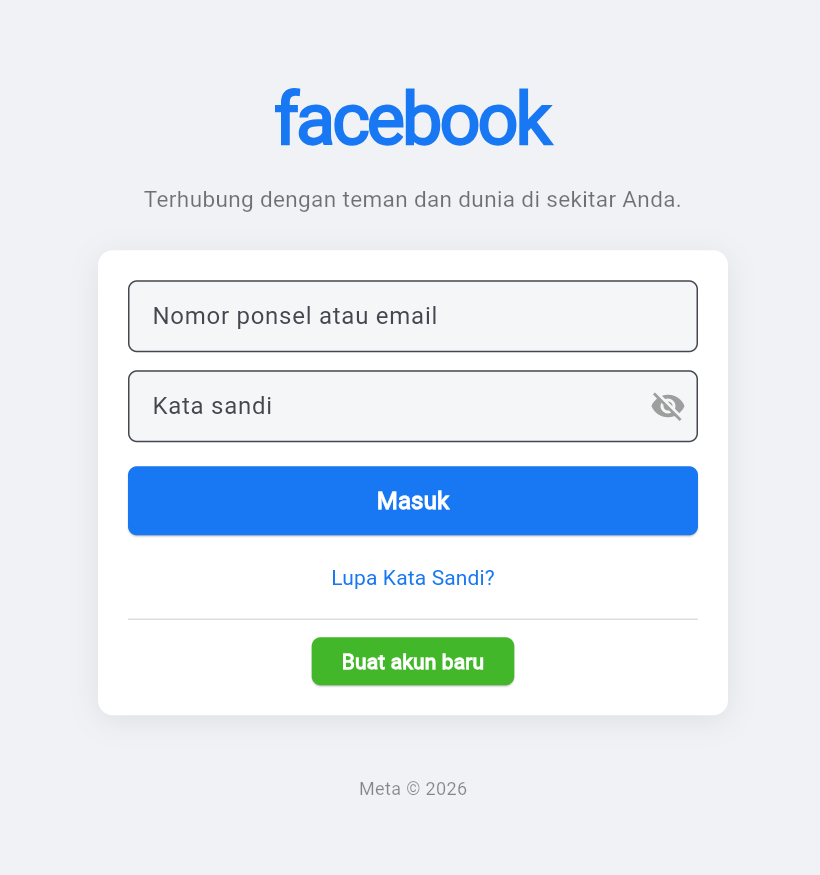
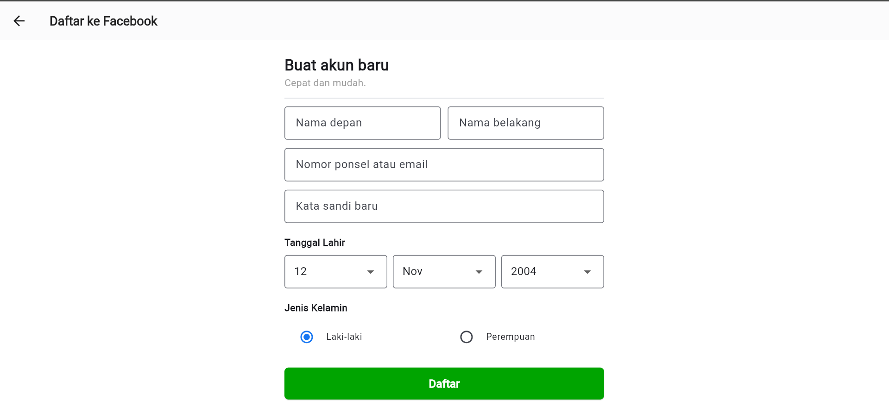
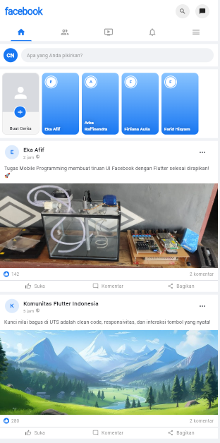
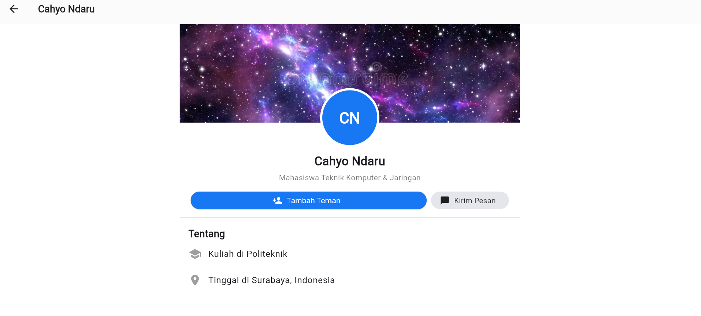

# Tugas UTS Mobile Programming - Facebook UI Clone (Flutter)

Aplikasi tiruan antarmuka (*UI Clone*) **Facebook** yang dibangun menggunakan framework **Flutter** dan bahasa pemrograman **Dart**. Proyek ini dibuat untuk memenuhi tugas Ujian Tengah Semester (UTS) mata kuliah Mobile Programming.

## Fitur & Halaman yang Diimplementasikan
1. **Halaman Login (`login_page.dart`)**
   * Validasi input format email (`@` dan domain lengkap) serta panjang kata sandi minimal 6 karakter.
   * Fitur tampilkan/sembunyikan kata sandi (*obscure text toggle*).
2. **Halaman Registrasi (`register_page.dart`)**
   * Formulir pendaftaran akun baru (Nama, Email/Ponsel, Tanggal Lahir, Jenis Kelamin).
   * Indikator kekuatan kata sandi (*Password Strength Meter*) dengan syarat wajib huruf kapital dan karakter spesial.
3. **Animasi Splash Screen (`splash_screen.dart`)**
   * Jeda transisi 2 detik dengan logo Facebook sebelum masuk ke halaman utama.
4. **Dashboard / Beranda (`home_page.dart`)**
   * **Navigasi 5 Tab Aktif:** Beranda (Feed), Permintaan Pertemanan, Facebook Watch, Notifikasi, dan Menu (termasuk tombol *Log Out*).
   * **Story Section & Status Box:** Deretan cerita pengguna horizontal serta dialog pembuatan status baru.
   * **Interaksi Postingan (`post_card.dart`):** Tombol *Like* dinamis, modal komentar unik di setiap postingan (bisa menambah komentar baru secara langsung), dan menu opsi postingan.
5. **Halaman Profil Dinamis (`profile_page.dart`)**
   * Menampilkan profil pengguna yang berbeda-beda sesuai avatar atau nama yang diklik pada feed, komentar, maupun story.

## Struktur Direktori (`lib/`)
```text
lib/
├── main.dart
├── screens/
│   ├── home_page.dart
│   ├── login_page.dart
│   ├── profile_page.dart
│   ├── register_page.dart
│   └── splash_screen.dart
└── widgets/
    ├── post_card.dart
    └── story_section.dart
```

# Cara Menjalankan Proyek
1. Clone repository ini:
git clone [https://github.com/ndarcuy/uts-flutter-facebook-clone.git](https://github.com/ndarcuy/uts-flutter-facebook-clone.git)

2. Masuk ke direktori proyek dan unduh dependensi:
cd uts-flutter-facebook-clone
flutter pub get

3. Jalankan aplikasi di browser Chrome:
flutter run -d chrome

## Tangkapan Layar (*Screenshots*)

### 1. Halaman Login & Registrasi
| Halaman Login | Halaman Register |
| :---: | :---: |
|  |  |

### 2. Dashboard & Halaman Profil
| Dashboard Beranda | Profil Pengguna |
| :---: | :---: |
|  |  |